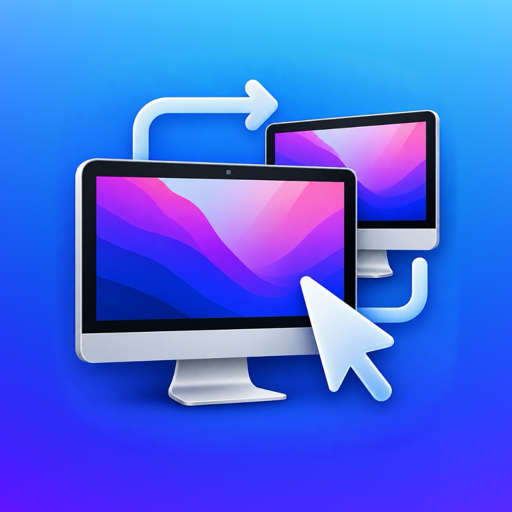

<div align="center">
  
  <h1>RemoteDesk</h1>
  <p><strong>High-performance, zero-dependency Mac-to-Mac remote desktop over your local network.</strong></p>

  <p>
    <a href="https://github.com/Alhamou/RemoteDesk/releases"></a>
    <a href="LICENSE"></a>
    
    
    <a href="https://github.com/Alhamou/RemoteDesk/releases"></a>
  </p>
</div>

---

RemoteDesk allows you to seamlessly share one Mac's display and control it from another Mac over your local area network (LAN) with near-zero latency. Built completely from the ground up in Swift with zero external dependencies, RemoteDesk leverages Apple's modern `ScreenCaptureKit` and `VideoToolbox` hardware H.264 acceleration.

- **Host (Controlled Mac)**: Streams screen capture via ScreenCaptureKit → VideoToolbox H.264 HW compression → length-prefixed TCP socket. Injects remote mouse/keyboard inputs via `CGEvent`.
- **Client (Controlling Mac)**: Hardware-decodes H.264 stream → presents directly via `CALayer` → captures mouse, keyboard, scroll, and clipboard events.

---

## ✨ Features

- **🚀 Native Hardware Acceleration**: Real-time H.264 encode and decode powered by Apple Silicon / Intel hardware accelerators via `VideoToolbox`.
- **⚡ Ultra-Low Latency Streaming**: Custom binary TCP protocol with zero B-frames and adaptive congestion control (hysteresis-based keyframe recovery).
- **🎯 Full Input Forwarding**: High-precision mouse cursor movement, left/right/middle clicks, dual-axis pixel-accurate scrolling, and virtual keyboard keycodes.
- **🖥️ Full-Screen "Capture All Input" Mode**: When entering full screen, RemoteDesk intercepts system shortcuts (`Cmd+Tab`, `Cmd+Space`, Mission Control) before macOS handles them locally, forwarding them directly to the remote host.
- **🎛️ Trackpad Gestures & Spaces**: In full screen, Spaces swipes, Mission Control, App Exposé and pinches act on the remote Mac (following your trackpad settings); forwarded `Ctrl+arrow` keys work too.
- **📐 Fit Remote to This Screen**: The host switches to the resolution that best matches the client's display, so full screen fills it edge to edge — restored automatically when you disconnect (*Window → Match Remote Resolution to This Screen*).
- **🧭 Clean Full-Screen Edges**: The local Dock stays hidden; bottom and side edges reach the remote Mac, and only the top edge reveals the local menu bar and window buttons.
- **📋 Bidirectional Clipboard Sync**: Automatically synchronizes text copied to the clipboard between both Macs in real time with circular loop suppression.
- **🔍 Zero-Config Discovery**: Advertises and discovers hosts automatically on your Wi-Fi/Ethernet subnet using Bonjour mDNS (`_remotedesk._tcp`), or connect directly via IP.
- **📦 Zero Third-Party Dependencies**: 100% native Swift relying strictly on macOS system frameworks (`ScreenCaptureKit`, `VideoToolbox`, `Network.framework`, `AppKit`).

---

## 📸 Screenshots

<div align="center">
  
  <p><em>RemoteDesk Launcher: Simple, instant Host and Client controls</em></p>
</div>

*(Additional screenshots of active remote desktop sessions in windowed and full-screen modes will be added in upcoming documentation updates).*

---

## 📋 Requirements

- **Operating System**: macOS 14.0 (Sonoma) or newer on both host and client Macs.
- **Architecture**: Universal binary supported (Apple Silicon `arm64` and Intel `x86_64`).
- **Network**: Both Macs must be reachable on the same local network, subnet, or secure VPN tunnel.
- **Permissions**:
  - **Host**: Screen Recording and Accessibility permissions.
  - **Client**: Accessibility permission (only required for full-screen "Capture All Input" mode).

---

## 💾 Installation

### Option 1: Download Pre-built DMG (Recommended)
Download the latest `RemoteDesk-1.1.0.dmg` from the **[Releases](https://github.com/Alhamou/RemoteDesk/releases)** page.

#### Gatekeeper Bypass (Unsigned App)
Because release binaries are currently distributed without a paid Apple Developer ID certificate, macOS Gatekeeper may show a warning:
> *"RemoteDesk cannot be opened because Apple cannot check it for malicious software."*

To open the application:
1. Open the DMG and drag `RemoteDesk.app` into `/Applications`.
2. **Right-click (or Control-click)** `RemoteDesk.app` in Finder, choose **Open**, and click **Open** in the dialog.
3. *Alternative via Terminal:* Remove the quarantine attribute directly:
   ```bash
   xattr -cr /Applications/RemoteDesk.app
   ```

### Option 2: Homebrew Cask (Personal Tap)
```bash
brew tap Alhamou/tap https://github.com/Alhamou/homebrew-tap
brew install --cask remotedesk
```

### Option 3: Build from Source
Ensure you have the Swift toolchain installed (Xcode or Xcode Command Line Tools):

```bash
# Clone the repository
git clone https://github.com/Alhamou/RemoteDesk.git
cd RemoteDesk

# Compile release app bundle
./scripts/make-app.sh

# Launch the app
open build/RemoteDesk.app
```

---

## 🚀 Usage

Launch `RemoteDesk.app` on both Macs.

### Host Mac (The Mac being controlled)
1. Launch RemoteDesk and click **Share This Mac**.
2. On first run, grant the system permission prompts:
   - **Screen Recording**: System Settings → Privacy & Security → Screen Recording (requires relaunching RemoteDesk after granting).
   - **Accessibility**: System Settings → Privacy & Security → Accessibility (enables remote mouse and keyboard control).
3. The host window will automatically minimize/hide while a client is actively connected so it does not obstruct your desktop. Click the Dock icon anytime to view status or disconnect.

### Client Mac (The Mac you sit at)
1. Launch RemoteDesk and click **Connect to a Mac**.
2. Select your host Mac from the Bonjour list, or enter its local IP address (e.g., `192.168.1.50:8790`).
3. Click **Connect**.

### Input Capture & Shortcuts

| Shortcut | Action | Description |
|:---|:---|:---|
| `Ctrl+Cmd+F` | Full Screen | Toggles full-screen view (automatically engages Input Capture). |
| `Ctrl+Opt+Cmd+G` | Toggle Input Capture | Manually engages/releases interception of system shortcuts. |
| `Ctrl+Opt+Cmd+Q` | Disconnect | Emergency disconnect shortcut (never forwarded to the host). |
| `Ctrl+Left / Right` | Switch Desktop | Switches virtual desktops (Spaces) on the remote Mac. |
| Pointer to top edge (full screen) | Local Controls | Reveals the local menu bar and window buttons (exit full screen / close). |

---

## 🔒 Security Model & Known Limitations

> [!CAUTION]
> **RemoteDesk is designed exclusively for trusted private local area networks (LANs).**

- **Unencrypted Plaintext Transport**: Network traffic is sent over raw TCP without TLS encryption. Screen frames and typed keystrokes are transmitted in plaintext across your subnet.
- **No Authentication Handshake**: Any device on the same local network that connects to the host port is granted full control.
- **Clipboard Sync**: Text copied to your clipboard is automatically broadcast to connected peers.

**Deployment Rule**: NEVER run RemoteDesk on untrusted public Wi-Fi (airports, hotels, cafes). For remote access across the internet, always tunnel traffic through a secure encrypted channel such as **Tailscale**, **WireGuard**, or **SSH Local Port Forwarding**:
```bash
# Example: Tunneling via SSH
ssh -N -L 8790:127.0.0.1:8790 user@remote-mac.local
RemoteDesk --client --connect 127.0.0.1:8790
```

*For comprehensive security disclosures, please review [SECURITY.md](SECURITY.md).*

---

## 💻 CLI Flags

RemoteDesk can be fully driven via the command line or run in headless mode:

```bash
# Start host headless
RemoteDesk --host --port 8790 --no-ui

# Connect client directly
RemoteDesk --client --connect 192.168.1.100:8790
```

| Flag | Default | Description |
|:---|:---|:---|
| `--host` | — | Runs as screen-sharing host |
| `--client` | — | Runs as client viewer |
| `--connect H[:P]`| — | Direct IP/hostname connection (default port `8790`) |
| `--browse` | — | Forces Bonjour discovery |
| `--port N` | `8790` | TCP port for listener or direct connection |
| `--no-ui` / `--headless` | — | Headless operation without window |
| `--self-test` | — | Runs internal protocol & codec verification tests and exits |
| `--test-pattern`| — | Streams synthetic test frames (no Screen Recording TCC needed) |
| `--expect-frames N` | — | Headless client exits `0` after decoding N frames |
| `--max-dim N` | `2560` | Caps the longest captured screen dimension |
| `--fps N` | `60` | Target frame rate (1–120 fps) |
| `--bitrate N` | `8000000` | Target average encoder bitrate (bits/sec) |
| `--verbose` | — | Enables debug logging on stderr |
| `--gesture-probe N`| — | Diagnostic: probes raw trackpad gesture events for N seconds |
| `--help` | — | Displays CLI options |

---

## 🧪 Testing & Verification

RemoteDesk provides comprehensive automated testing capabilities that do not require GUI interactions or TCC approvals:

```bash
# 1. Run Swift unit tests
swift test

# 2. Run offline protocol and VideoToolbox codec test
swift build
.build/debug/RemoteDesk --self-test

# 3. Run automated end-to-end loopback test
./scripts/e2e-test.sh
```

---

## 🏗️ Architecture Overview

RemoteDesk decouples the streaming pipeline into isolated queues:
- **`ScreenCapturer`**: Uses Apple's `ScreenCaptureKit` (`SCStream`) for hardware-level display capture.
- **`VideoEncoder`**: Compresses raw `CVPixelBuffer`s into H.264 AVCC NAL units using `VTCompressionSession`.
- **`PeerConnection`**: Manages non-blocking TCP socket communication over `Network.framework`.
- **`VideoDecoder`**: Decompresses incoming NAL units via `VTDecompressionSession` into `IOSurface`-backed pixel buffers.
- **`RemoteView`**: Renders decompressed frames directly to a hardware-accelerated `CALayer` and handles mouse/keyboard events.

*For an in-depth explanation of the wire protocol, congestion control, and concurrency model, see [docs/ARCHITECTURE.md](docs/ARCHITECTURE.md).*

---

## 🗺️ Roadmap

- [ ] TLS transport encryption using self-signed certificates or Pre-Shared Keys (PSK).
- [ ] PIN / One-Time Password (OTP) connection authorization prompt on the host.
- [ ] Audio capture and streaming via `SCStream` audio outputs.
- [ ] Multi-monitor selection and switching.
- [ ] Automatic display resolution negotiation and dynamic frame scaling.

---

## 🤝 Contributing

Contributions, bug reports, and suggestions are welcome! Please check out [CONTRIBUTING.md](CONTRIBUTING.md) and our [Code of Conduct](CODE_OF_CONDUCT.md) before submitting pull requests.

---

## 📄 License

RemoteDesk is open-source software licensed under the **[MIT License](LICENSE)**.
Copyright © 2026 Emad Alhamou.
